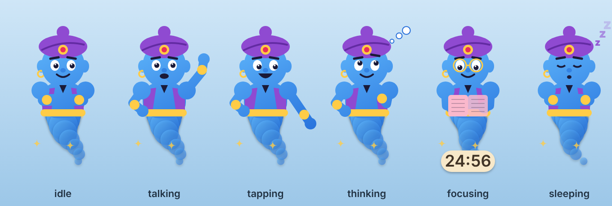

# Genie 🧞

A little genie who lives on your Mac. He floats around your screen, sits on top of your windows,
naps on the Dock, and grants wishes by actually doing things: he flies to an app's Dock icon,
taps it, and the app opens.



Native macOS app: Swift, SwiftUI and AppKit. The genie is drawn in code, so there are no art files.

## Run it

You need macOS 14 (Sonoma) or newer and Xcode, or just the command line tools (`xcode-select --install`).

```bash
git clone <this repo>
cd desktop-companion
swift run                 # quickest way to try it
# or build a real app you can double-click:
./scripts/make-app.sh && open build/Genie.app
```

You can also open `Package.swift` in Xcode and press ▶︎.

A 🧞 appears in your menu bar. Press **⌥ Space**, or click the genie, to open the chat bar.

## Things to try

These work for free, with no AI:

| Type | What happens |
|---|---|
| `open Spotify` | Flies to the Dock, taps Spotify, it opens |
| `open youtube` | Taps your browser and opens YouTube |
| `search cute cats` | Google search |
| `quit Music` | Asks "Quit Music?" first, then quits it |
| `help me focus` / `focus 45` | Focus timer. He puts on glasses and reads next to a countdown |
| `nap` / `follow me` | Naps on the Dock / follows your cursor |

He also does things on his own: wanders around, sits on top of the window you're using, watches
your cursor, and falls asleep when you're away. Hover over him for a second to wake him up, and drag him anywhere.

## Optional: real AI chat with Claude

Choose 🧞 → **Set Claude API key…** and paste a key from [console.anthropic.com](https://console.anthropic.com).
After that, anything that isn't a simple command goes to Claude, which can use all of the genie's powers
(open/quit/hide apps, websites, focus timer). The key is stored in your Keychain. API usage is billed by Anthropic.

## Permissions

- **Accessibility** (🧞 → Grant Accessibility access…) lets him find Dock icons so he can fly to the right one.
  Without it, everything still works, but he taps the middle of the Dock.
  When you use `swift run`, the permission is granted to Terminal. When you use `Genie.app`, it's granted to the app.
  After rebuilding the app, you may need to remove it from the Accessibility list and add it again.

## Code map

| File | What it does |
|---|---|
| `GenieApp.swift` | App startup, menu bar, ⌥Space, sends chat to commands or Claude |
| `GenieBrain.swift` | Behavior and movement: wandering, perching, napping, flying to targets, focus timer, speech bubble |
| `GenieView.swift` | The genie drawing and his poses, the speech bubble, the timer |
| `ChatBar.swift` | The frosted chat bar |
| `Powers.swift` | What he can do, plus the free built-in commands |
| `MacActions.swift` | macOS calls: apps, windows, Dock icons |
| `ClaudeClient.swift` | Claude Messages API with tool use |
| `Support.swift` | Floating windows, hotkey, Keychain |

See [PLAN.md](PLAN.md) for the roadmap.
